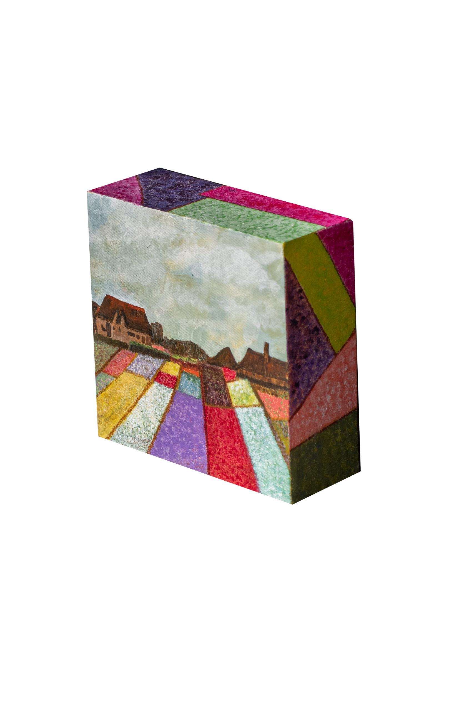

(20 cm X 20 cm)

From our time in Holland. The whole country is filled with flowers and the canals provide sharp relief. After visiting the Van Gogh museum I could not wait to use his style of painting in this box. Here I wanted to show endless tulip gardens flowing out from the canvas box.
